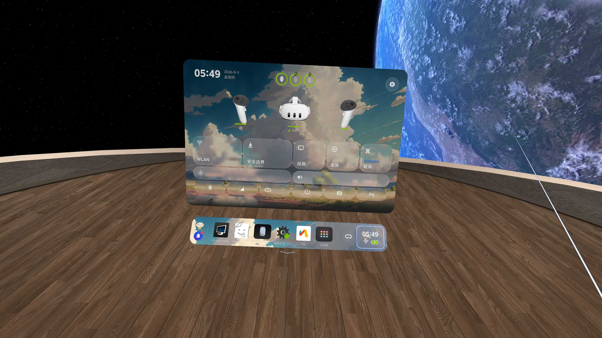

# PICO 4 Quest 3 Swap

[中文](#中文) | [English](#english) | [Русский](#русский)

<a id="中文"></a>
## 中文

一个 PICO 4 的 LSPosed / Zygisk-Vector 小模块：把快捷设置面板里的 PICO 4 设备插画(头显 + 双手柄)换成 **Meta Quest 3 的正视渲染图**。

### 效果

打开 Dock 右侧的快捷设置面板,你会看到 Quest 3 的头显和 Touch Plus 手柄,而不是 PICO 4 的设备图。



### 素材来源

- **头显**:Meta 官方新闻中心的透明底正视渲染图(三摄像头正脸,与原槽位角度完全一致)
- **手柄**:维基百科高分辨率 Touch Plus 正视实拍 + AI 抠图

### 特点

- 仅作用于 `com.picovr.settings` 的快捷面板,不改系统 APK、不开额外权限
- 图片以 Base64 分段内嵌于代码,无需联网、无外部依赖
- 替换在面板打开时执行,面板关闭后自动还原

### 使用

1. 安装 APK,在 LSPosed / Zygisk-Vector 启用模块,作用域只选 **PICO 设置**
2. 强制停止“设置”或重启头显
3. 打开 Dock 右侧的快捷设置面板查看效果

### 构建

```sh
./gradlew assembleDebug
```

调试 APK 输出位置:

```text
app/build/outputs/apk/debug/app-debug.apk
```

### 支持环境

仅在已 root 且安装 LSPosed / Zygisk-Vector 的 PICO 4(固件 5.13.7)上验证;系统更新可能改变 Hook 目标。

---

<a id="english"></a>
## English

A tiny LSPosed / Zygisk-Vector module for PICO 4: swaps the quick settings panel's PICO 4 device art (headset + controllers) for **official Meta Quest 3 renders**.

### What it looks like

Open the quick settings panel on the right side of the Dock and you'll see the Quest 3 headset and Touch Plus controllers instead of the PICO 4 device art.


### Art sources

- **Headset**: official transparent front render from Meta's newsroom (three cameras, matches the original slot angle exactly)
- **Controllers**: high-resolution Touch Plus front photo from Wikipedia + AI cutout

### Features

- Only hooks the quick settings panel inside `com.picovr.settings`; no system APK modification, no extra permissions
- Images are embedded as chunked Base64 in the code — no network, no external dependencies
- Applied when the panel opens and automatically reverts when it closes

### Usage

1. Install the APK and enable the module in LSPosed / Zygisk-Vector with scope set to **PICO Settings** only
2. Force-stop Settings or reboot the headset
3. Open the quick settings panel on the right side of the Dock

### Build

```sh
./gradlew assembleDebug
```

Debug APK output:

```text
app/build/outputs/apk/debug/app-debug.apk
```

### Requirements

Tested only on a rooted PICO 4 (firmware 5.13.7) with LSPosed / Zygisk-Vector. Firmware updates may change hook targets.

---

<a id="русский"></a>
## Русский

Небольшой модуль LSPosed / Zygisk-Vector для PICO 4: заменяет изображения устройств PICO 4 (шлем + контроллеры) в панели быстрых настроек на **официальные рендеры Meta Quest 3**.

### Как это выглядит

Откройте панель быстрых настроек справа от дока — вместо изображений PICO 4 вы увидите шлем Quest 3 и контроллеры Touch Plus.


### Источники изображений

- **Шлем**: официальный прозрачный фронтальный рендер из пресс-центра Meta (три камеры, полностью совпадает с исходным углом)
- **Контроллеры**: фронтальное фото Touch Plus высокого разрешения из Википедии + AI-вырезка

### Особенности

- Работает только с панелью быстрых настроек внутри `com.picovr.settings`; системный APK не изменяется, дополнительные разрешения не требуются
- Изображения встроены в код как фрагментированный Base64 — без сети и внешних зависимостей
- Применяется при открытии панели и автоматически откатывается при закрытии

### Использование

1. Установите APK и включите модуль в LSPosed / Zygisk-Vector, выбрав область действия только **PICO Settings**
2. Принудительно остановите «Настройки» или перезагрузите шлем
3. Откройте панель быстрых настроек справа от дока

### Сборка

```sh
./gradlew assembleDebug
```

Отладочный APK:

```text
app/build/outputs/apk/debug/app-debug.apk
```

### Требования

Протестировано только на рутированном PICO 4 (прошивка 5.13.7) с LSPosed / Zygisk-Vector. Обновления прошивки могут изменить цели хуков.
